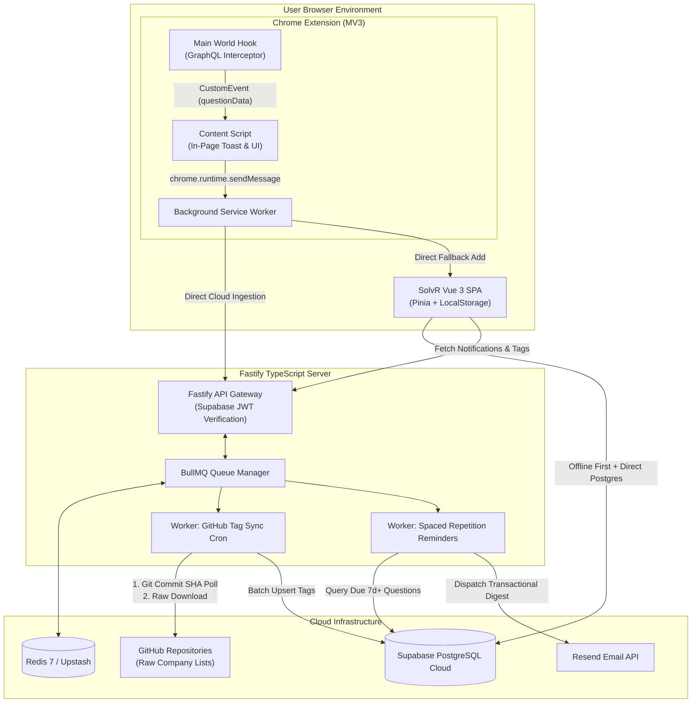

# SolvR Full-Stack Platform & Automated Ingestion Architecture

*   **Author:** Abhinav Arya
*   **Status:** Draft
*   **Date:** 2026-11-16

--------------------------------------------------------------------------------

## Overview

SolvR is an interview preparation and competitive programming tracker designed for software engineers practicing algorithmic problem solving on platforms like LeetCode and Codeforces. This document details the system design for evolving SolvR from a client-only single-page application into an enriched full-stack platform.

The system incorporates:
1. A dedicated TypeScript backend service (Fastify) and background job queue (BullMQ on Redis) to automate data synchronization and transactional notifications.
2. A scheduled cron pipeline to synchronize curated company tags from public GitHub repositories into PostgreSQL without exceeding API quotas.
3. An enhanced Manifest V3 browser extension that captures problem metadata directly via network stream inspection rather than brittle DOM scraping.
4. A hybrid sharing mechanism that encodes lightweight roadmaps into compressed, stateless URL fragments, falling back to database-persisted shortlinks for large collections.
5. An in-app notification center coupled with scheduled transactional email reminders to reinforce spaced repetition (7-day review intervals).

The core invariant of SolvR is preserved: offline-first operation. The client application must remain completely usable when disconnected from the network, with backend services acting strictly as an asynchronous enrichment layer.

## The Problem

Preparing for technical interviews requires solving dozens or hundreds of algorithmic problems across fragmented platforms (LeetCode, Codeforces, HackerRank). Candidates face several recurring friction points:

1. **Manual Logging Overhead**: Manually switching tabs to record problem titles, URLs, tags, and difficulty ratings disrupts practice flow. Existing extension prototypes rely on full-tab redirects that pull users away from their active coding session.
2. **Brittle Problem Scraping**: Extensions that parse DOM trees break frequently when platforms update their web layouts, class names, or client-side hydration lifecycles.
3. **Lack of Spaced Repetition Discipline**: Problem solvers frequently forget algorithms they completed weeks prior. Without automated reminders across both in-app indicators and email digests, retention degrades.
4. **Outdated Company Tag Data**: Identifying which problems are actively asked by target companies (e.g., Google, Meta, Amazon) requires consulting third-party GitHub lists that fall out of sync with personal trackers.
5. **Sharing Overhead and Privacy Concerns**: Sharing a curated problem set with a mentor or peer typically requires creating a public account or hosting a centralized database sheet. Users need an immediate way to export and view roadmaps without forced account creation.

## Goals

*   **Zero-Friction Capture**: Enable one-click problem ingestion on LeetCode and Codeforces with an in-page toast notification, eliminating tab switching and manual data entry.
*   **Resilient Ingestion Pipeline**: Inspect network responses (GraphQL and platform REST APIs) rather than scraping DOM classes, preventing layout-induced breakage.
*   **Spaced Repetition Enforcement**: Automatically schedule and deliver 7-day review nudges via an in-app notification center and timezone-aware transactional emails.
*   **Automated Company Tag Sync**: Maintain up-to-date company tags in PostgreSQL via an automated worker that monitors GitHub datasets while respecting API rate limits.
*   **Stateless Sheet Sharing**: Allow users to share problem sheets via compressed URL hashes (`< 2 KB`) with zero database writes, supporting an automatic shortlink fallback for larger sheets.
*   **Offline-First Invariant**: Ensure 100% of core tracking functionality (problem logging, editing, filtering, and local persistence) remains operational without network connectivity or backend availability.

## Non-Goals

*   **Real-Time Collaborative Editing**: Synchronous multi-user live editing (such as Google Docs or collaborative spreadsheets) is out of scope. Shared sheets are static snapshots.
*   **Scraping Paywalled Editorial Content**: The system will not bypass authentication paywalls or scrape copyrighted solution write-ups from LeetCode Premium.
*   **Native Mobile Application**: No native iOS or Android apps will be constructed; mobile access is provided through responsive browser views.
*   **Replacing Supabase RLS with Custom Auth**: The backend will not replace Supabase Auth. It will verify Supabase JWTs to maintain consistent user authorization.

## Open Questions

*   **Question 1**: Which curated GitHub repository will serve as the initial primary source for LeetCode company-wise problem mappings, and what JSON/Markdown schema does it expose?
*   **Question 2**: For the Chrome extension network interception on LeetCode, should the background service worker use `chrome.declarativeNetRequest` rule matches or inject an inline `fetch`/`XMLHttpRequest` wrapper into the main page context to capture the GraphQL response body?

## Critical User Journeys (CUJs)

### CUJ 1: One-Click Problem Capture from LeetCode
*   **Given**: A user is browsing `leetcode.com/problems/two-sum/` with the SolvR Chrome extension installed and paired.
*   **When**: The user clicks the injected "+ Add to SolvR" button in the problem header (or submits an accepted solution).
*   **Then**: The extension captures problem metadata from the intercepted GraphQL query `questionData` (Title: "Two Sum", Slug: "two-sum", Difficulty: "Easy", Tags: ["Array", "Hash Table"]). An in-page glassmorphic toast appears confirming the save, and the problem is synchronized to local storage and the cloud without opening a new tab.

### CUJ 2: Spaced Repetition Notification & Actionable Email Digest
*   **Given**: A user practiced "Course Schedule" 7 days ago and has email reminders enabled for 08:00 UTC.
*   **When**: The hourly BullMQ reminder worker executes at 08:00 UTC and identifies due revision items.
*   **Then**: A transactional email is dispatched via Resend displaying due problems with direct platform links and recall prompts. Simultaneously, an in-app notification is created in the PostgreSQL `notifications` table, incrementing the unread badge on the SolvR header bar.

### CUJ 3: Zero-Friction Snapshot Sheet Sharing
*   **Given**: A user selects 30 graph problems in their SolvR list and clicks "Share Sheet".
*   **When**: The client serializes and compresses the problem ID tokens using `lz-string` into a URL hash (`https://solvr.dev/share#data=...`).
*   **Then**: A peer opening the link enters a read-only preview mode displaying the 30 problems, with options to "Save as New Sheet" or "Merge into My Problems", leaving existing local storage untouched.

### CUJ 4: Offline Problem Tracking with Graceful Degradation
*   **Given**: A user loses internet connectivity or the Fastify backend server experiences an outage.
*   **When**: The user creates a new problem entry, modifies tags, or views their activity heatmap.
*   **Then**: All operations succeed immediately against `localStorage`. No blocking modal or unhandled network exceptions appear. Pending cloud sync requests queue locally until connectivity is restored.


--------------------------------------------------------------------------------

## Technical Plan (Architecture)

### 1. Monorepo Topology & System Boundaries

To manage shared data structures, server workers, and browser extension codebases without code duplication, the repository transitions to an npm/pnpm workspace topology:

```
/SolvR
├── package.json                  (Root workspace orchestrator)
├── packages/
│   ├── client/                   (Vue 3 + Vite + Tailwind SPA from /src)
│   ├── extension/                (Manifest V3 Chrome Extension)
│   ├── server/                   (Fastify TypeScript backend + BullMQ workers)
│   └── shared/                   (Pure TypeScript contracts & codecs)
└── supabase/                     (PostgreSQL migrations, RLS policies)
```

#### Strict Architectural Invariants:
1. **Offline Autonomy**: `packages/client` maintains 100% feature viability against browser `localStorage` and Supabase client SDK. It never depends synchronously on `packages/server`.
2. **Zero-Dependency Shared Package**: `packages/shared` contains pure TypeScript types (`Question`, `Difficulty`, `SharePayload`, `NotificationDTO`) and pure encoding utilities (e.g. `lz-string` token codecs) with zero DOM or Node.js runtime bindings.
3. **One-Way Extension Communication**: `packages/extension` communicates with the web client via `chrome.runtime.sendMessage` and with `packages/server` via authenticated REST endpoints.

### 2. High-Level Architecture & Data Flow



### 3. Backend Service Architecture (`packages/server`)

The backend is built with Fastify v4 in TypeScript, offering low memory overhead, rapid startup, and native JSON schema serialization.

#### A. Authentication & Authorization Bridge
The backend does not manage independent user tables or custom JWT signing keys. Instead, it acts as a verified consumer of Supabase Auth:
- Incoming HTTP requests carry the `Authorization: Bearer <supabase_access_token>` header.
- A Fastify preHandler hook verifies the token using the Supabase client (`supabase.auth.getUser(token)`).
- Authenticated requests bind `request.user = { id, email }`.
- Background worker processes interact with PostgreSQL using the privileged `SUPABASE_SERVICE_ROLE_KEY` with RLS bypass for batch synchronization.

#### B. BullMQ Queue & Worker Topology
BullMQ coordinates asynchronous background execution over Redis 7 (or Upstash Redis):

1. **`cron-company-tags` Queue**:
   - **Trigger**: Repeatable job scheduled daily at 03:00 UTC.
   - **Step 1 (Rate-Limit Protection)**: Query GitHub Commits API for the target repository:  
     `GET https://api.github.com/repos/{owner}/{repo}/commits?path=data.json&page=1&per_page=1`
   - **Step 2 (Conditional Fetch)**: Compare the commit SHA with the `last_synced_sha` recorded in PostgreSQL. If identical, log a cache hit and terminate immediately (cost: 1 API call).
   - **Step 3 (Ingestion & Normalization)**: If modified, fetch the raw payload via `https://raw.githubusercontent.com/{owner}/{repo}/main/data.json`. Parse company question frequency scores, normalize problem slugs, and execute a bulk upsert into `public.company_tags`.

2. **`email-reminders` Queue**:
   - **Trigger**: Repeatable job scheduled hourly at minute 0.
   - **Worker Logic**:
     1. Identify active users whose configured `preferred_reminder_hour_utc` matches the current UTC hour.
     2. Query problems where `is_revision = true` and `last_practiced_at < NOW() - INTERVAL '7 days'`.
     3. For each eligible user with > 0 due problems, compile an HTML reminder digest containing direct practice links and recall prompts.
     4. Dispatch the message via the Resend API (`POST https://api.resend.com/emails`) with mandatory `List-Unsubscribe` headers.
     5. Insert corresponding rows into `public.notifications` for in-app badge display.

### 4. Chrome Extension Architecture (`packages/extension`)

The extension is upgraded to Manifest V3 with a hybrid execution model that eliminates brittle DOM scraping:

#### A. Network Interception via Main World Hook
LeetCode executes on Next.js/React and fetches problem data via internal GraphQL POST requests. Content scripts in standard isolated worlds cannot intercept `window.fetch` responses directly.
- **Implementation**: The extension registers a Main World script in `manifest.json`:
  ```json
  "content_scripts": [
    {
      "matches": ["https://leetcode.com/problems/*"],
      "js": ["mainWorldInterceptor.js"],
      "world": "MAIN",
      "run_at": "document_start"
    },
    {
      "matches": ["https://leetcode.com/problems/*", "https://codeforces.com/problemset/problem/*"],
      "js": ["content.js"],
      "world": "ISOLATED",
      "run_at": "document_idle"
    }
  ]
  ```
- **Interception Mechanism**: `mainWorldInterceptor.js` wraps `window.fetch`. When a POST request to `/graphql` contains the query name `questionData`, it clones the response stream, parses the JSON payload, and emits a `CustomEvent("solvr:problem_detected", { detail: metadata })` to the document root.
- **Isolated Content Script**: `content.js` listens for `solvr:problem_detected`, storing the verified metadata (question ID, title, slug, difficulty, tags).

#### B. In-Page Glassmorphic Toast
Instead of triggering disruptive tab redirects (`window.open`), `content.js` injects a shadow DOM container containing a glassmorphic toast notification:
- **States**:
  - *Default Dock*: Contextual "+ SolvR" button rendered adjacent to LeetCode's problem title.
  - *Success Toast*: `✓ Added "Two Sum" (Easy) to SolvR [Change Topic ▾] [Open SolvR ↗]`.
  - *Duplicate Notice*: `ℹ "Two Sum" already tracked (Last solved: 4 days ago) [Mark Solved Today]`.

#### C. SPA Route Transition Observer
LeetCode transitions between problems via client-side routing without triggering `DOMContentLoaded`. The content script attaches a `MutationObserver` to the main application container and hooks into `history.pushState` / `window.onpopstate` to re-verify current URL parameters and reset the capture button state.

#### D. 1-Click Extension Authentication Pairing
In `manifest.json`, SolvR declares:
```json
"externally_connectable": {
  "matches": ["https://solvr.dev/*", "https://*.vercel.app/*", "http://localhost:*/*"]
}
```
Inside the SolvR web app settings, a "Pair Extension" button dispatches `chrome.runtime.sendMessage(EXTENSION_ID, { type: "AUTH_HANDSHAKE", token, user })`. The background service worker saves the credentials into `chrome.storage.local`, enabling direct API syncing without manual token entry.

### 5. Hybrid Sheet Sharing Subsystem

To balance viral zero-friction sharing with database storage efficiency, SolvR implements a two-tier sharing architecture:

```
[User Clicks "Share Sheet"]
          │
          ▼
Compute Payload Size (Dictionary Tokenized)
          │
    ┌─────┴────────────────────────┐
    ▼                              ▼
Payload <= 2,048 Bytes         Payload > 2,048 Bytes
(Stateless URL Hash)           (Database Shortlink)
    │                              │
    ├─ Compress via lz-string      ├─ POST /api/share (Store in PostgreSQL)
    ├─ Format: /share#data=<hash>  ├─ Format: /share/:shortId
    ▼                              ▼
[Shareable URL Output]         [Shareable URL Output]
```

#### A. Dictionary Tokenization Algorithm
Full JSON serialization of questions is discarded in favor of compact tokenization:
- Format: `<PlatformCode>:<ProblemIdentifier>:<TopicId>:<DifficultyCode>`
- Example: `LC:1:DP:1,LC:15:2P:2,CF:158A:MATH:1`
- A 50-problem roadmap requires ~300 raw bytes, which compresses with `lz-string` (`compressToEncodedURIComponent`) into ~140 ASCII characters.

#### B. Recipient Isolation & Forking UX
When a user navigates to `/share#data=...` or `/share/:shortId`:
1. The client decompressor parses the payload into a transient Pinia store slice (`sharedSheetStore.ts`).
2. The user's active `localStorage` questions are untouched.
3. A top preview banner is displayed:
   `Viewing Shared Sheet: "NeetCode Core 40" (40 Questions) • [Fork as New Sheet] [Merge with My Problems] [Close]`
4. If "Fork as New Sheet" is clicked, the problems are imported with fresh local UUIDs and reset practice timestamps.

### 6. Database Schema Extensions (Supabase PostgreSQL)

```sql
-- 1. Curated company tags synchronized from GitHub
CREATE TABLE public.company_tags (
  id UUID PRIMARY KEY DEFAULT gen_random_uuid(),
  platform TEXT NOT NULL DEFAULT 'LeetCode',
  problem_slug TEXT NOT NULL,
  company_name TEXT NOT NULL,
  frequency_score NUMERIC(5,2) DEFAULT 1.0,
  synced_at TIMESTAMPTZ DEFAULT NOW(),
  CONSTRAINT uq_platform_problem_company UNIQUE(platform, problem_slug, company_name)
);

CREATE INDEX idx_company_tags_lookup ON public.company_tags (company_name, platform);
CREATE INDEX idx_company_tags_slug ON public.company_tags (problem_slug);

-- 2. In-app notifications
CREATE TABLE public.notifications (
  id UUID PRIMARY KEY DEFAULT gen_random_uuid(),
  user_id UUID NOT NULL REFERENCES public.profiles(id) ON DELETE CASCADE,
  type TEXT NOT NULL, -- 'spaced_repetition', 'streak_risk', 'company_update', 'system'
  title TEXT NOT NULL,
  body TEXT NOT NULL,
  action_url TEXT,
  is_read BOOLEAN DEFAULT FALSE,
  created_at TIMESTAMPTZ DEFAULT NOW()
);

CREATE INDEX idx_notifications_user_unread ON public.notifications (user_id, is_read, created_at DESC);

-- 3. User notification & reminder preferences
CREATE TABLE public.user_notification_settings (
  user_id UUID PRIMARY KEY REFERENCES public.profiles(id) ON DELETE CASCADE,
  email_reminders_enabled BOOLEAN DEFAULT TRUE,
  preferred_reminder_hour_utc SMALLINT DEFAULT 8 CHECK (preferred_reminder_hour_utc BETWEEN 0 AND 23),
  reminder_frequency TEXT DEFAULT 'daily' CHECK (reminder_frequency IN ('daily', 'weekly')),
  unsubscribe_token UUID DEFAULT gen_random_uuid(),
  updated_at TIMESTAMPTZ DEFAULT NOW()
);

-- 4. Hybrid share storage (for payloads > 2 KB)
CREATE TABLE public.shared_sheets (
  short_id TEXT PRIMARY KEY, -- Base62 8-char nanoid
  creator_id UUID REFERENCES public.profiles(id) ON DELETE SET NULL,
  title TEXT NOT NULL,
  payload_json JSONB NOT NULL,
  view_count INTEGER DEFAULT 0,
  created_at TIMESTAMPTZ DEFAULT NOW(),
  expires_at TIMESTAMPTZ DEFAULT (NOW() + INTERVAL '180 days')
);

CREATE INDEX idx_shared_sheets_created ON public.shared_sheets (created_at DESC);

-- Row Level Security (RLS) Policies
ALTER TABLE public.company_tags ENABLE ROW LEVEL SECURITY;
ALTER TABLE public.notifications ENABLE ROW LEVEL SECURITY;
ALTER TABLE public.user_notification_settings ENABLE ROW LEVEL SECURITY;
ALTER TABLE public.shared_sheets ENABLE ROW LEVEL SECURITY;

-- Anyone can read company tags and shared sheets
CREATE POLICY "Public read for company tags" ON public.company_tags FOR SELECT USING (true);
CREATE POLICY "Public read for shared sheets" ON public.shared_sheets FOR SELECT USING (true);

-- Users can create shared sheets
CREATE POLICY "Users can insert shared sheets" ON public.shared_sheets FOR INSERT WITH CHECK (true);

-- Notifications are strictly private to the recipient
CREATE POLICY "Users manage own notifications" ON public.notifications
  FOR ALL USING (auth.uid() = user_id);

-- Notification settings are strictly private to the user
CREATE POLICY "Users manage own notification settings" ON public.user_notification_settings
  FOR ALL USING (auth.uid() = user_id);
```


--------------------------------------------------------------------------------

## Alternatives Considered

### Alternative A: Pure DOM Scraping in Browser Extension

*   **Pros**: Simple initial implementation using standard query selectors (`document.querySelector`); avoids injecting scripts into LeetCode's main execution context.
*   **Cons**: Highly fragile against LeetCode and Codeforces UI redesigns, obfuscated CSS class names, dynamic React hydration lifecycles, and client-side page routing without reloads.
*   **Reason for Rejection**: *Rejected by author*: Brittle UI class names break scrapers whenever platforms update their frontend codebases. Intercepting internal GraphQL queries (`questionData`) and REST responses at the network layer captures structured JSON payloads directly with zero reliance on layout stability.

### Alternative B: Naive Full-JSON Serialization in Share URLs

*   **Pros**: Directly serializes question models using `JSON.stringify` and standard base64/compression; requires no custom tokenization codec.
*   **Cons**: Storing problem titles, URLs, tags, and user notes causes URLs to exceed 4,000 characters for sheets with 40+ problems. Long URLs break on messaging platforms (Slack, Discord, Twitter, WhatsApp) and exceed browser address bar limits.
*   **Reason for Rejection**: *Rejected by author*: URL length bloat makes sharing unwieldy. Implementing a numerical ID dictionary tokenization scheme (`LC:<id>,CF:<id>`) compresses a 50-problem roadmap to under 200 bytes. Sheets exceeding 2 KB automatically fallback to a database-backed shortlink (`/share/:shortId`).

### Alternative C: Serverless Edge Functions Exclusively (Supabase Edge + pg_cron)

*   **Pros**: Eliminates the operational maintenance of a dedicated Fastify container and stateful Redis cluster; zero monthly infrastructure cost during low usage.
*   **Cons**: Edge functions enforce strict wall-clock execution timeouts (typically 60–150 seconds) and memory limits, making them unsuitable for cloning or decompressing large GitHub repositories. Furthermore, edge functions lack a persistent queue state machine for exponential backoff, retry dead-letter queues, and granular rate-limiting across email providers.
*   **Reason for Rejection**: *Rejected by author*: Insufficient runtime guarantees for repository diffing and lack of persistent BullMQ queue orchestration. The dedicated Fastify server provides reliable background worker execution, while the frontend preserves offline independence.

### Alternative D: Direct GitHub REST API Polling Without Commit SHA Verification

*   **Pros**: Standard API querying using `@octokit/rest` without caching or state verification layers.
*   **Cons**: Unauthenticated requests to GitHub's REST API are strictly throttled at 60 requests per hour per IP. Automated crons querying multiple repository endpoints quickly hit rate limits, causing data sync failures.
*   **Reason for Rejection**: *Rejected by author*: Excessive API consumption. Querying GitHub's Commits API (`GET /repos/{owner}/{repo}/commits?path=data.json`) consumes exactly 1 API call to inspect the latest commit SHA. If unchanged, the worker exits immediately; if modified, the raw file is downloaded via `raw.githubusercontent.com` CDN without impacting REST API quotas.

--------------------------------------------------------------------------------

## Non-Functional Requirements

### 1. Security & Privacy
*   **Token Verification**: Fastify does not hold long-lived custom credentials. It validates Supabase JWTs per request via Supabase Auth public keys / `supabase.auth.getUser()`.
*   **Service Role Key Isolation**: The `SUPABASE_SERVICE_ROLE_KEY` is restricted exclusively to background workers inside `packages/server` and is never bundled into `packages/client` or `packages/extension`.
*   **Email Privacy & Anti-Spam Compliance**: All transactional emails sent via Resend include valid `List-Unsubscribe` headers, a one-click unsubscribe token linking to `public.user_notification_settings`, and strict double opt-in controls.

### 2. Performance & Latency
*   **Offline-First Latency**: Core problem operations (creation, filtering, tag editing, heatmap updates) must execute synchronously in < 16ms against in-memory Pinia state and browser `localStorage`.
*   **Stateless Link Decompression**: Decoding and parsing a compressed roadmap URL (`#data=...`) must complete in < 50ms using `lz-string` without external network requests.
*   **Extension Overhead**: The Main World fetch interceptor on LeetCode must introduce < 2ms latency on `/graphql` requests, ensuring no degradation of LeetCode's code execution or page rendering speeds.

### 3. Rollout & Rollback Strategy
*   **Non-Breaking Schema Migrations**: All PostgreSQL schema updates (`company_tags`, `notifications`, `shared_sheets`, `user_notification_settings`) are additive and will not modify existing `questions` or `profiles` tables.
*   **Extension Backward Compatibility**: The Chrome extension continues supporting manual URL parsing and fallback navigation if network interception encounters an unmapped GraphQL query.
*   **Server Outage Degradation**: If `packages/server` or Redis becomes unavailable, the client application displays a subtle offline indicator and suppresses cloud sync requests without blocking local problem logging.


--------------------------------------------------------------------------------

## Detailed Implementation Plan

This section provides the comprehensive file-by-file blueprint required to implement the full-stack architecture. Implementation work proceeds in four discrete stages across the monorepo workspace.

### Target Files to Create/Modify

#### 1. Workspace Configuration & Shared Contracts (`packages/shared/`)

##### `package.json` (Workspace Root) — [Modify]
*   **Type / Scope**: Monorepo root configuration.
*   **Proposed Changes**: Configure npm/pnpm workspace roots (`"workspaces": ["packages/*"]` or root scripts), adding unified orchestrator scripts: `npm run dev` (concurrent client, server, extension builds), `npm run build` (topological build across packages), `npm run test` (Vitest across workspaces), and `npm run lint`.
*   **Rationale**: Coordinates multi-package development, dependency linking, and continuous integration testing.

##### `packages/shared/package.json` — [Create]
*   **Type / Scope**: Shared contract manifest.
*   **Proposed Changes**: Define `@solvr/shared` package manifest with `main: "./dist/index.js"`, `types: "./dist/index.d.ts"`, and build scripts using `tsc`.
*   **Rationale**: Exposes common TypeScript contracts and codecs to both client and server packages without circular dependencies.

##### `packages/shared/tsconfig.json` — [Create]
*   **Type / Scope**: TypeScript build configuration.
*   **Proposed Changes**: Configure strict compilation targeting ES2022 / CommonJS & ESM outputs with declaration generation (`"declaration": true`).
*   **Rationale**: Guarantees strict type safety and portability across Node.js (Fastify) and browser (Vue/Vite) runtimes.

##### `packages/shared/src/index.ts` — [Create]
*   **Type / Scope**: Package public API gateway.
*   **Proposed Changes**: Re-export all type contracts from `./types/` and encoding utilities from `./codecs/`.
*   **Rationale**: Provides a single unified import path (`import { ... } from '@solvr/shared'`).

##### `packages/shared/src/types/question.ts` — [Create]
*   **Type / Scope**: Domain type contracts.
*   **Proposed Changes**: Declare canonical TypeScript interfaces for `Question`, `Difficulty` (`'Easy' | 'Medium' | 'Hard'`), `Platform` (`'LeetCode' | 'Codeforces' | 'HackerRank' | 'GeeksforGeeks' | 'CodeChef' | 'Other'`), and `CompanyTagRecord`.
*   **Rationale**: Establishes a single source of truth for problem models across the client, backend workers, and Chrome extension.

##### `packages/shared/src/types/sharing.ts` — [Create]
*   **Type / Scope**: Sharing protocol contracts.
*   **Proposed Changes**: Declare interfaces for `ShareSnapshotPayload` (`title`, `creatorName`, `version`, `problemTokens`, `createdAt`) and `DecodedShareSheet`.
*   **Rationale**: Standardizes the data contract for both compressed URL hashes and database shortlink records.

##### `packages/shared/src/types/notification.ts` — [Create]
*   **Type / Scope**: Notification data models.
*   **Proposed Changes**: Declare `NotificationDTO` (`id`, `userId`, `type`, `title`, `body`, `actionUrl`, `isRead`, `createdAt`) and `UserNotificationSettings` (`emailRemindersEnabled`, `preferredReminderHourUtc`, `frequency`).
*   **Rationale**: Unifies notification payloads across PostgreSQL, Fastify REST responses, and Pinia client stores.

##### `packages/shared/src/codecs/tokenCodec.ts` — [Create]
*   **Type / Scope**: Serialization codec.
*   **Proposed Changes**: Implement `encodeProblemTokens(questions: Question[]): string` and `decodeProblemTokens(tokenString: string): Partial<Question>[]`. Encodes items into compact format `<PlatformCode>:<ID>:<TopicId>:<DifficultyCode>`.
*   **Rationale**: Shrinks question representations by >85% compared to raw JSON strings, keeping shared roadmaps within browser URL limits.

##### `packages/shared/src/codecs/compressor.ts` — [Create]
*   **Type / Scope**: Compression utility.
*   **Proposed Changes**: Expose `compressPayload(rawString: string): string` and `decompressPayload(compressedString: string): string` wrapping `lz-string` URL-safe base64 methods.
*   **Rationale**: Ensures consistent, deterministic URL string compression and decompression across client and server.

##### `packages/shared/src/__tests__/tokenCodec.spec.ts` — [Create]
*   **Type / Scope**: Unit test suite.
*   **Proposed Changes**: Validate token packing efficiency, lossless roundtrip decoding, handling of non-standard platforms, and malformed token recovery.
*   **Rationale**: Prevents data corruption during stateless sheet URL sharing.

---

#### 2. Chrome Extension Modernization (`packages/extension/`)

##### `packages/extension/manifest.json` — [Modify]
*   **Type / Scope**: Chrome extension manifest.
*   **Proposed Changes**: Declare `mainWorldInterceptor.js` with `world: "MAIN"`, `content.js` with `world: "ISOLATED"`, `externally_connectable` matching SolvR domains, and permissions for `storage`, `declarativeNetRequest`, and host permissions for `https://leetcode.com/*` and `https://codeforces.com/*`.
*   **Rationale**: Enables main-world GraphQL response inspection and secure web-app authentication handshakes.

##### `packages/extension/mainWorldInterceptor.js` — [Create]
*   **Type / Scope**: In-page network hook.
*   **Proposed Changes**: Wrap `window.fetch` in LeetCode's execution context. Detect POST requests to `/graphql` matching `questionData`, clone the response stream, parse question metadata (ID, title slug, difficulty, tags), and dispatch a `CustomEvent("solvr:problem_detected")` to the DOM.
*   **Rationale**: Captures structured problem data directly from the network stream, avoiding DOM scraping failures.

##### `packages/extension/content.js` — [Modify]
*   **Type / Scope**: Isolated content script.
*   **Proposed Changes**: Listen for `solvr:problem_detected` events, mount an isolated Shadow DOM container for the in-page glassmorphic toast notification, and attach a `MutationObserver` to track LeetCode Next.js SPA route transitions.
*   **Rationale**: Provides immediate in-page capture feedback without disrupting the candidate's active coding session.

##### `packages/extension/toast.css` — [Create]
*   **Type / Scope**: UI styling.
*   **Proposed Changes**: Define glassmorphism CSS styles (backdrop blur, subtle border highlights, entrance/exit slide animations) scoped strictly inside the Shadow DOM to avoid CSS collisions with LeetCode.
*   **Rationale**: Delivers a visual experience consistent with SolvR's glassy design aesthetic.

##### `packages/extension/background.js` — [Modify]
*   **Type / Scope**: MV3 Service Worker.
*   **Proposed Changes**: Handle `chrome.runtime.onMessageExternal` for authentication pairing from the SolvR web app, persist Supabase JWT and user profiles in `chrome.storage.local`, and execute authenticated problem sync requests to Fastify/Supabase.
*   **Rationale**: Removes manual API key entry and handles cross-origin problem ingestion.

---

#### 3. Backend Service & Queue Workers (`packages/server/`)

##### `packages/server/package.json` — [Create]
*   **Type / Scope**: Backend package manifest.
*   **Proposed Changes**: Declare dependencies for `fastify`, `@fastify/cors`, `@fastify/jwt`, `bullmq`, `ioredis`, `resend`, `@supabase/supabase-js`, `dotenv`, and devDependencies for `tsx`, `typescript`, `vitest`.
*   **Rationale**: Initializes the dedicated TypeScript backend application.

##### `packages/server/tsconfig.json` — [Create]
*   **Type / Scope**: TypeScript configuration.
*   **Proposed Changes**: Configure Node.js 20+ compilation targeting modern ES modules.
*   **Rationale**: Enables native ESM imports and strict type checking.

##### `packages/server/src/index.ts` — [Create]
*   **Type / Scope**: Application entry point.
*   **Proposed Changes**: Initialize Fastify, register CORS and JWT plugins, register API routes (`/api/notifications`, `/api/tags`, `/api/share`), connect Redis, initialize BullMQ workers, and register graceful process shutdown handlers (`SIGTERM`, `SIGINT`).
*   **Rationale**: Coordinates server lifecycle, HTTP routing, and worker initialization.

##### `packages/server/src/config/env.ts` — [Create]
*   **Type / Scope**: Environment configuration.
*   **Proposed Changes**: Validate and export typed configuration variables: `PORT`, `REDIS_URL`, `SUPABASE_URL`, `SUPABASE_SERVICE_ROLE_KEY`, `RESEND_API_KEY`, and `GITHUB_TOKEN` (optional).
*   **Rationale**: Fails fast on application startup if required secrets or connection URLs are missing.

##### `packages/server/src/services/redis.ts` — [Create]
*   **Type / Scope**: Infrastructure connector.
*   **Proposed Changes**: Export singleton `ioredis` connection instance configured with retry backoff, keep-alive pinging, and connection error logging.
*   **Rationale**: Supplies shared, resilient Redis connections to Fastify and BullMQ queue workers.

##### `packages/server/src/queues/queueManager.ts` — [Create]
*   **Type / Scope**: BullMQ queue orchestration.
*   **Proposed Changes**: Instantiate `company-tags-sync` (daily repeatable job) and `email-reminders` (hourly repeatable job) BullMQ queues.
*   **Rationale**: Configures recurring schedule timings, retry parameters, and concurrency limits.

##### `packages/server/src/workers/companyTagsWorker.ts` — [Create]
*   **Type / Scope**: Background cron worker.
*   **Proposed Changes**: Implement worker logic that: (1) queries GitHub Commits API for the latest commit SHA, (2) verifies against PostgreSQL `last_synced_sha`, (3) downloads raw JSON archive via CDN if changed, and (4) executes batch upsert into `public.company_tags`.
*   **Rationale**: Maintains up-to-date company tags automatically while consuming only 1 GitHub API request per day on cache hits.

##### `packages/server/src/workers/emailReminderWorker.ts` — [Create]
*   **Type / Scope**: Background reminder worker.
*   **Proposed Changes**: Implement worker logic that: (1) queries users whose configured reminder hour matches the current UTC hour, (2) queries questions where `is_revision = true` and `last_practiced_at < NOW() - INTERVAL '7 days'`, (3) renders an HTML digest template with practice links, (4) dispatches via Resend API, and (5) writes in-app notifications to PostgreSQL.
*   **Rationale**: Automates spaced repetition retention with zero manual effort required from the candidate.

##### `packages/server/src/routes/tags.ts` — [Create]
*   **Type / Scope**: HTTP API endpoint.
*   **Proposed Changes**: Expose `GET /api/tags/companies` (list available companies) and `GET /api/tags/companies/:name` (list problem slugs associated with a specific company).
*   **Rationale**: Provides problem tagging metadata to the frontend search and filter chips.

##### `packages/server/src/routes/share.ts` — [Create]
*   **Type / Scope**: HTTP API endpoint.
*   **Proposed Changes**: Expose `POST /api/share` (store large sheet payload > 2 KB into `public.shared_sheets`, generating an 8-character nanoid) and `GET /api/share/:shortId` (retrieve stored payload and increment view counter).
*   **Rationale**: Powers the hybrid sharing fallback for complex roadmaps that exceed URL hash length limits.

##### `packages/server/src/routes/notifications.ts` — [Create]
*   **Type / Scope**: HTTP API endpoint.
*   **Proposed Changes**: Expose `GET /api/notifications` (fetch user unread notifications) and `PATCH /api/notifications/:id/read` (mark notification as read).
*   **Rationale**: Powers the client in-app notification drawer.

---

#### 4. Frontend Client Modernization (`packages/client/` / `src/`)

##### `src/stores/notificationStore.ts` — [Create]
*   **Type / Scope**: Pinia client store.
*   **Proposed Changes**: Manage notification list, unread counter badge, polling / Supabase Realtime row listeners, and dismissal handlers (`markAsRead`, `markAllAsRead`).
*   **Rationale**: Provides reactive state management for in-app spaced repetition and sync alerts.

##### `src/stores/sharedSheetStore.ts` — [Create]
*   **Type / Scope**: Pinia client store.
*   **Proposed Changes**: Manage transient shared preview state (`previewSheet`, `isSharedPreviewActive`), decode URL hash parameters, and provide actions: `forkSheetAsNew()` and `mergeIntoActiveSheet()`.
*   **Rationale**: Isolates recipient previews from active user local storage, preventing accidental data overwrites.

##### `src/components/NotificationDrawer.vue` — [Create]
*   **Type / Scope**: Vue 3 UI component.
*   **Proposed Changes**: Flyout glassmorphic drawer rendered on header bell click, displaying categorized alerts (*Spaced Repetition Due*, *Streak at Risk*, *Company Updates*) with 1-click solve actions.
*   **Rationale**: Provides immediate visibility and resolution for due review problems.

##### `src/components/SharedSheetModal.vue` — [Create]
*   **Type / Scope**: Vue 3 UI component.
*   **Proposed Changes**: Modal dialog displayed when opening a share URL, presenting sheet title, problem count, difficulty breakdown, and action CTAs (`Fork Roadmap`, `Merge`, `Dismiss`).
*   **Rationale**: Ensures clear recipient onboarding when reviewing shared problem lists.

##### `src/components/HeaderBar.vue` — [Modify]
*   **Type / Scope**: Top navigation bar component.
*   **Proposed Changes**: Add notification bell button with dynamic unread badge counter, and add "Share Sheet" button triggering URL generation.
*   **Rationale**: Surfaces core sharing and notification entry points in the primary navigation.

##### `src/components/SearchFilter.vue` — [Modify]
*   **Type / Scope**: Filtering and search component.
*   **Proposed Changes**: Add Company Tag multi-select chip dropdown (populated dynamically from `company_tags` with options: Google, Meta, Amazon, Microsoft, Apple, Uber) alongside existing Topic, Platform, and Difficulty filters.
*   **Rationale**: Enables rapid filtering for company-specific interview sprint preparation.

##### `src/components/SettingsModal.vue` — [Modify]
*   **Type / Scope**: User preferences modal.
*   **Proposed Changes**: Add "Browser Extension Pairing" button triggering `chrome.runtime.sendMessage` handshake, and add Spaced Repetition email reminder toggles with UTC hour selector.
*   **Rationale**: Gives candidates granular control over email frequency, notification timing, and extension authorization.

##### `src/utils/shareUrl.ts` — [Create]
*   **Type / Scope**: Client sharing utility.
*   **Proposed Changes**: Implement `generateShareLink(questions: Question[], title: string): Promise<string>`. Evaluates dictionary-tokenized byte length: returns `https://solvr.dev/share#data=<hash>` if <= 2 KB; queries `POST /api/share` and returns `https://solvr.dev/share/:shortId` if > 2 KB.
*   **Rationale**: Encapsulates hybrid link routing logic transparently.

##### `src/tests/shareUrl.spec.ts` — [Create]
*   **Type / Scope**: Vitest test suite.
*   **Proposed Changes**: Validate URL length calculations, encoding/decoding accuracy for typical sheets (10, 30, 60 problems), and graceful handling of corrupted hash strings.
*   **Rationale**: Guarantees sharing link reliability across browser environments.

##### `src/tests/notificationStore.spec.ts` — [Create]
*   **Type / Scope**: Vitest test suite.
*   **Proposed Changes**: Test notification state updates, unread count calculations, mark-as-read persistence, and offline fallback behavior.
*   **Rationale**: Verifies notification store logic and state transitions.

---

#### 5. Database Schema & Migrations (`supabase/`)

##### `supabase/migrations/20261116000000_platform_enrichment.sql` — [Create]
*   **Type / Scope**: PostgreSQL migration script.
*   **Proposed Changes**: Execute DDL statements for `company_tags`, `notifications`, `user_notification_settings`, `shared_sheets`, indexes, and Row Level Security policies.
*   **Rationale**: Applies reproducible schema changes in local and cloud Supabase environments.

##### `supabase/schema.sql` — [Modify]
*   **Type / Scope**: Master database schema.
*   **Proposed Changes**: Append the new tables, constraints, foreign keys, and RLS policies into the canonical database documentation contract.
*   **Rationale**: Maintains the drift-free schema contract verified during EGM bootstrap audits.

---

#### 6. Documentation Updates

##### `README.md` (Root) — [Modify]
*   **Type / Scope**: Project documentation.
*   **Proposed Changes**: Update system architecture diagram, monorepo workspace instructions, backend setup guides, and environment variable requirements.
*   **Rationale**: Ensures clear onboarding instructions for new developers.

##### `src/README.md` — [Modify]
*   **Type / Scope**: Client package documentation.
*   **Proposed Changes**: Document the shared store interfaces, notification drawer, and hybrid share URL utilities.
*   **Rationale**: Maintains architectural clarity for the frontend package.

##### `extension/README.md` — [Modify]
*   **Type / Scope**: Extension documentation.
*   **Proposed Changes**: Document Manifest V3 network interception mechanisms, main-world script injection, and pairing protocol.
*   **Rationale**: Documents extension architecture and local loading steps in Chrome.

##### `supabase/README.md` — [Modify]
*   **Type / Scope**: Database documentation.
*   **Proposed Changes**: Document new tables (`company_tags`, `notifications`, `shared_sheets`, `user_notification_settings`) and RLS authorization models.
*   **Rationale**: Maintains contract integrity across database packages.

--------------------------------------------------------------------------------

### Verification Plan

```
1. Build & Static Analysis Validation:
   - Root Workspace Build: `npm run build` (Must build @solvr/shared, packages/server, and packages/client with 0 TypeScript errors).
   - Type Checking: `vue-tsc -b` on client and `tsc --noEmit` on server and shared packages with 0 errors.
   - Code Formatting & Linting: `npm run lint` across all packages with 0 warnings or errors.

2. Unit Test Suites (Vitest):
   - Shared Codecs: `npx vitest run packages/shared/src/__tests__/tokenCodec.spec.ts` (100% pass).
   - Client Sharing: `npx vitest run src/tests/shareUrl.spec.ts` (100% pass).
   - Client Notifications: `npx vitest run src/tests/notificationStore.spec.ts` (100% pass).
   - Server Workers: `npx vitest run packages/server/src/__tests__/` (100% pass for tag sync and reminder workers).
   - Existing Baseline: All 90 existing unit tests in src/ must continue passing without regression.

3. End-to-End Functional Verification:
   - Extension Capture: Load unpacked extension in Chrome, navigate to https://leetcode.com/problems/two-sum/, verify main-world fetch hook captures GraphQL questionData, and verify glassmorphic toast appears without tab redirect.
   - Stateless Sharing: Generate share link for a 30-problem sheet, open in an incognito window, verify read-only preview loads in < 50ms with existing local storage untouched, and test "Fork as New Sheet" action.
   - Company Tag Ingestion: Trigger companyTagsWorker locally with mock GitHub commit SHA, verify raw download, and verify PostgreSQL public.company_tags upsert.
   - Offline Invariant Test: Disconnect network / shut down Fastify server, perform problem addition and filtering in Vue SPA, and verify 0 blocking errors.
```

--------------------------------------------------------------------------------

*Drafted with EGM*
